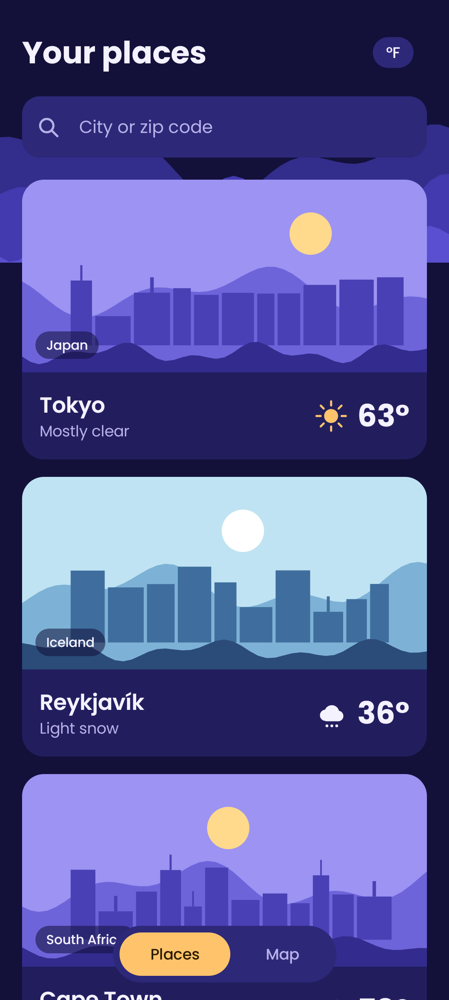
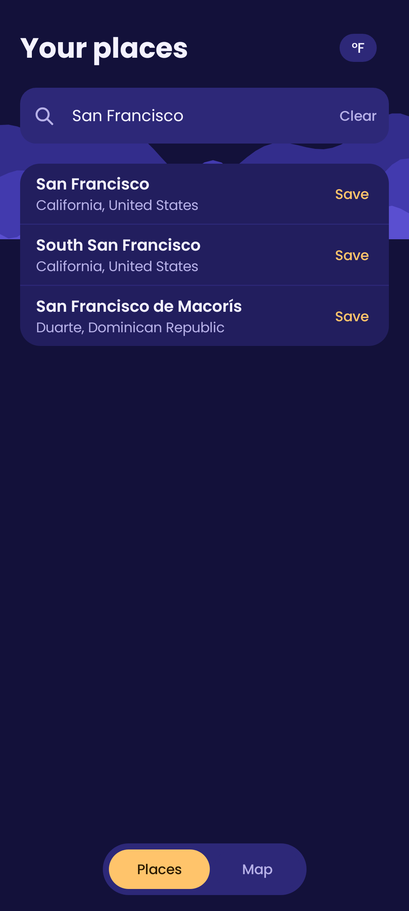
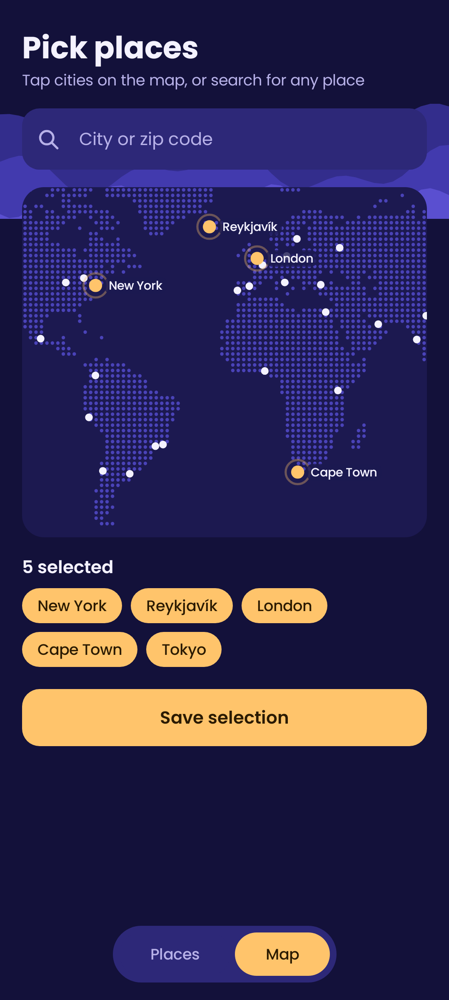
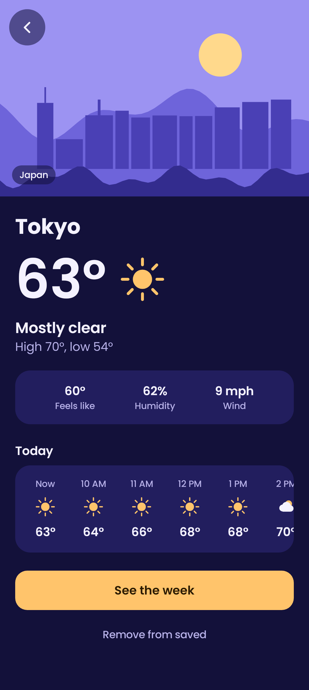
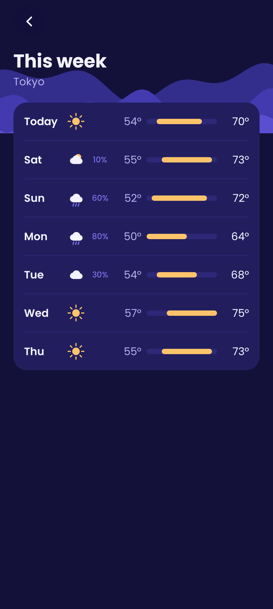
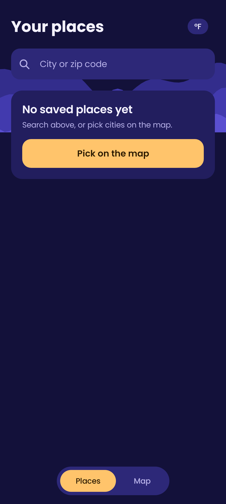

# Example app: Meridian Weather

The first app built with android-on-debian. It's a Compose weather app,
scaffolded with `adx app-template new MeridianWeather com.mensuramedia.meridian`.
It lives in its own repo at `~/projects/android-apps/MeridianWeather`.

Features:

- Pick major cities on an offline dot-matrix world map.
- Search by city or zip code (Open-Meteo geocoding).
- Save places as large cards with generated 2D place art.
- See current conditions, the next 12 hours and the 7-day forecast.

The design follows `samples/theme-01` (a JPEG reference), checked against
the Hallmark skill's floor rules.

## Mockups (Roborazzi renders from fixture data)

| Places | Search | Map picker |
| --- | --- | --- |
|  |  |  |

| Detail | Week | Empty state |
| --- | --- | --- |
|  |  |  |

The sample temperatures in the mockups are illustrations, not observations.
To regenerate them, run `./gradlew recordRoborazziDebug` in the app.

## What it exercised in the framework

| Framework piece | Result |
| --- | --- |
| `adx app-template new` | Scaffold built on the first try; only app code was added |
| Roborazzi render loop | 6 screens rendered in about 10 s once dependencies were cached; caught a map-label overlap before any device run |
| `adx emulator start --window` | Booted in about 6 s (quick boot); `installDebug` ran with live Open-Meteo data |
| Vendored Hallmark skill | Its floor rules shaped the theme tokens, the bans and the word budget |
