# aodm: phone image manager (technical document)

Design and development record of `aodm`, the android-on-debian phone image
manager. Filled in phase by phase (status per section); the feature status is
in [ROADMAP.md](../ROADMAP.md), measured emulator behaviour in
[research/aodm-spike.md](research/aodm-spike.md).



## 1. Purpose and terms *(P0, done)*

- **Image**: one Android Virtual Device (AVD): `~/.android/avd/<name>.ini` + `<name>.avd/`.
- **Save**: a full copy of an image at a point in time, reopenable in place or as a new image.
- **Template**: a versioned recipe (or golden save) that builds new images.
- **Identity policy**: how an image's identity fields are set (`private`, `standard`, `fixed`).
- **Lock**: a per-image security control the manager enforces.
- **Spin-off**: an image turned into a standalone phone (`aod-phone`), linked or portable.

## 2. Architecture *(P1, in progress)*

Cargo workspace `tools/aodm/` (edition 2024, Rust 1.95 pinned in
`rust-toolchain.toml`, `Cargo.lock` committed, `--locked` everywhere,
`unsafe_code = "forbid"`, clippy `-D warnings`, `cargo deny` policy in `deny.toml`).

| Crate | Status | Role |
| --- | --- | --- |
| `aod-core` | P1: `env`, `log`, `ini`, `error`; P2: `avd`, `proc`, `registry`, `card` | Library, no terminal I/O; shared by every front end |
| `aodm` | P2: `list [--group G]`, `card`, `env`, `--version` | CLI (clap); TUI from P8 |
| `aod-phone` | P7 | Standalone phone runtime + mechanics panel |
| `aod-gui` | P10a: phone cards with live screen thumbnails; Start / Stop / Save / Clone through `aodm` | eframe window (glow; X11 or Wayland). Lists images in-process (`card::image_rows`), screenshots with raw `adb exec-out screencap` (RGBA, shrunk to 200 px), keeps the last screen in `$ADX_AOD_HOME/thumbs/NAME.thumb` (0600) |

### Built in P1

- **`env`**: one source of truth, adx's precedence. `config/defaults.env` +
  `config/local.env` are sourced through bash with the real environment (the
  framework is found via `ADX_ROOT`, else the root baked in at build time), so
  config files win and only `${VAR:-default}` keys take environment overrides
  (sandbox: `ADX_AOD_HOME`, `ADX_AOD_SAVES_DIR`, `ANDROID_AVD_HOME`); then the
  environment for keys the config doesn't set; then built-in fallbacks (a test
  keeps them equal to defaults.env). `aodm env` shows each value, its source,
  and warns about environment values that are ignored.
- **`log`**: appends to `$ADX_LOG_DIR/adx.log` in adx's exact format
  (`YYYY-mm-dd HH:MM:SS LEVEL [aodm #run] msg`), one write per line, size
  rotation and generation shift identical to adx; never fails a command.
- **`ini`**: lossless `config.ini` editor: byte-identical round trip on the
  real AVD file, `set` changes one value in place (keeps spacing, order,
  comments, trailing newline), last occurrence wins, atomic save.
- **`error`**: typed errors (`Io`, `Parse`, `Config`; more per phase) so front
  ends can react.

## 3. Data on disk *(P2, done for inventory)*

| Path | What | Read by |
| --- | --- | --- |
| `<avd home>/<name>.ini` | `path=` (absolute), `path.rel=` (relative to the Android user home), `target=android-<api>` | `avd::scan`: folder = first existing `*.avd` dir of `path=`, `<user home>/path.rel`, `<avd home>/<name>.avd`. AVD home as the emulator resolves it: `ANDROID_AVD_HOME`, else `$ANDROID_EMULATOR_HOME/avd`, else `$ANDROID_USER_HOME/avd`, else `~/.android/avd` |
| `<name>.avd/config.ini` | hardware/device/image keys (`hw.*`, `abi.type`, `tag.id`, `image.sysdir.1`); `avd.id`/`avd.name` are literal `<build>` placeholders | `avd::Image` accessors, lossless `ini` editor |
| `<name>.avd/` | qcow2 disks (relative backing files), `snapshots/default_boot/` (quick-boot; `hardware.ini` and `snapshot.pb` hold the folder's absolute path), per-run files (`hardware-qemu.ini`, `emu-launch-params.txt`, lock files) | size via allocated blocks (`du`); copied by saves/clone (P4) |
| `$ANDROID_HOME/<image.sysdir.1>/source.properties` | system image `Pkg.Revision` | version card / list `REV` |
| `/proc/<pid>/cmdline` | running emulators: qemu process name + `-avd`/`-port` | `proc::emulators` (never matches shells) |
| `$ADX_AOD_HOME/images.toml` | registry: groups, pinned port, template, origin; unknown keys preserved; atomic save | `registry::Registry` |

Images whose folder or `config.ini` is missing, and junk entries (a directory
or dangling link named `*.ini`, an unreadable or non-UTF-8 `.ini`) are still
listed as `broken`, with the reason, so one bad entry never hides the rest.
Only the current user's emulators count as running; `-avd NAME` and the
launcher's `@NAME`, `-port N` and `-ports N,M` are recognised. Sizes count
allocated blocks, stay on one filesystem, and count hard links once. Names aodm accepts: letters, digits, `.`,
`_`, `-`, 1–64 characters, not starting with `.` or `-`.
## 4. Saves, clone, rename, delete *(P4, done)*

```
$ADX_AOD_SAVES_DIR/<image>/<YYYYmmdd-HHMMSS>Z[-label]/   (UTC: sorts by time)
  avd/            the image folder (quick-boot snapshot included, per-run files dropped)
  image.ini       the image's <name>.ini at save time
  manifest.toml   format = 1, aodm version, image, source folder, label, created, target/abi/tag,
                  system image and emulator revisions, size + SHA-256 of every file
  pinned          (optional) kept by prune, not counted against ADX_AOD_MAX_SAVES
```

- **The lock.** Every command that changes an image holds an exclusive flock
  on its `multiinstance.lock`, the lock the emulator takes itself. Checked on
  37.2.13: while aodm holds it, `emulator -avd` exits with "Another emulator
  instance is running". So a running image is refused ("stop it first"), and
  nothing can start it mid-copy. A qemu process running the image is refused
  too (`-read-only` emulators skip the lock).
- **Inputs.** Image arguments are image names, never paths. An image folder
  that is a symlink is refused (copies would copy the link and edit the live
  folder); `delete` removes only the link. `ADX_AOD_SAVES_DIR`,
  `ADX_AOD_HOME` and `ANDROID_AVD_HOME` must be absolute. The saves folder
  must be on a POSIX filesystem (ext4, btrfs, xfs).
- **Interruptions.** `cp` and `sha256sum` run in aodm's process group, so
  Ctrl-C stops them with aodm. Work happens in hidden folders named with the
  aodm pid (`.…partial-PID`, `.…restore-PID`, `.deleting-…-PID`); every P4
  command first removes those whose process is gone and logs it ("removed
  leftover of an interrupted run"). Copies are synced (`syncfs`) before any
  original is removed.
- **Create.** Refuses a broken image, too many unpinned saves
  (`ADX_AOD_MAX_SAVES`; never prunes by itself) and too little space (image
  size + 1 GiB). Copies with `cp --archive --sparse=always --reflink=auto` into
  `.partial-<pid>`, drops per-run files, hashes the copy (`sha256sum`), writes
  the manifest, renames into place. Plain files only (a symlink is refused).
  On failure the partial folder is removed.
- **Verify.** Re-hashes and reports missing, changed and unexpected files.
- **Restore in place.** Verifies first (a damaged save is never restored),
  copies next to the image, then swaps both folders in one atomic
  `renameat2(RENAME_EXCHANGE)`: at no moment is the image without a folder;
  the old state is then removed. The quick-boot snapshot is kept when the image lives
  in the folder it was saved from, otherwise dropped (cold boot).
  `--backup-first` saves the current state first. The system image isn't in
  the save: a changed revision is reported (expect a cold boot).
- **Open as new / clone.** Same copy-in step: `.<name>.avd.partial-<pid>`,
  per-run files and the snapshot dropped (its paths name the old folder),
  `avd.id`/`avd.name` set, renamed into place, `<name>.ini` written
  (`path=`, `path.rel=` under the Android user home, `target=`), `origin`
  recorded in the registry (`image@save` or the source image). First boot is
  cold. The copy keeps the source's Android ID until identity policies (P5).
- **Rename.** Moves the folder in place, rewrites `config.ini` and the `.ini`,
  drops the snapshot, moves the registry entry and the saves folder. A failure
  before the new `.ini` is written is undone; a later one says exactly what to
  move by hand.
- **Delete.** Removes the `.ini`, then renames the folder to a hidden
  `.deleting-` name and removes it, then the registry entry; keeps the saves.
  The prompt shows the folder. Works on broken images. Never removes a folder that another image's
  `.ini` also points at.
- **adx's image.** `ADX_AVD_NAME` can't be renamed or deleted by aodm (adx
  depends on the name); clone it instead.
- **Registry.** Writers use `Registry::update`: flock on
  `$ADX_AOD_HOME/images.lock`, load, change, atomic save with `schema = 1`;
  a file with a newer schema is never overwritten. Every P4 command checks
  this before it changes anything on disk.
- **Measured** (this laptop, ext4, no reflink): save of a 4.9 GB image 6.5 s,
  verify 3.3 s, open as new 6 s, clone 6 s, restore + quick boot 4 s.
## 5. Running many emulators *(P3, done)*

`aodm start|stop|restart|health TARGETS`: TARGETS are image names, `--all`,
`--group G`, and/or `--running` (alone: every running image). `health` with
no TARGETS checks every image.

- **Ports.** adb discovers emulators only on console ports 5554–5584 (even;
  adb port = console + 1): 16 slots from `ADX_AOD_BASE_PORT`. Reserved ports
  (a `port` pin in `images.toml`, and `ADX_EMU_PORT` for adx's own
  `ADX_AVD_NAME`) belong to their image only, so `adx emulator start` always
  finds its port. Otherwise the first slot that no running emulator uses and
  where both ports bind on 127.0.0.1. `$ADX_AOD_HOME/ports.lock` (flock) is
  held from port choice until every emulator of the run has booted, so two
  aodm runs never pick the same port.
- **Running check**: an image is running when an own-user qemu process runs
  `-avd <name>` (`/proc` scan) **and** that image's `multiinstance.lock` is
  held (exclusive flock by the emulator, verified on 37.2.13). A same-named
  emulator from another AVD home (a sandbox) is therefore never stopped,
  restarted or wiped; a held lock with no own emulator is refused. All of it
  is re-read after taking `ports.lock`.
- **Budget.** Before anything starts: running + new ≤ `ADX_AOD_MAX_INSTANCES`;
  the guest RAM of the new images (`hw.ramSize`) + `ADX_AOD_RAM_RESERVE_MB` ≤
  `MemAvailable` (running guests are already counted there). Emulator cores
  above host threads only warn. One refusal stops the whole start.
- **Launch.** Same flags as `adx emulator start`: `-avd N -port P -gpu
  $ADX_EMU_GPU -no-boot-anim`, `-no-window -no-audio` when headless. The
  emulator gets the `ANDROID_HOME`, `ANDROID_AVD_HOME`, `ANDROID_USER_HOME`,
  `ANDROID_EMULATOR_HOME` aodm resolved, then `ADX_EMU_ENV`; log in
  `$ADX_LOG_DIR/emulator-<image>.log` (`ADX_LOG_KEEP` previous runs kept). `--cold`
  adds `-no-snapshot-load`, `--wipe` adds `-wipe-data` after a typed
  confirmation (or `--yes`). The emulator runs in its own process group, so
  Ctrl-C or closing aodm's terminal leaves it running.
- **Boot.** All images of one run boot in parallel; each waits for
  `sys.boot_completed=1` and fails fast if the emulator exits, if adb still
  says `unauthorized` after 60 s (hint: `--wipe`), or after
  `ADX_EMU_BOOT_TIMEOUT`. A failed boot that is still alive is stopped like
  `stop` does (identity check, console kill, SIGTERM), so it doesn't hold a
  port; one that exited is only reaped.
- **Stop.** Console `avd name` must equal the image (a reused port can't stop
  another emulator), then `kill` (the emulator saves its quick-boot snapshot)
  and up to 30 s to exit; then SIGTERM and 15 s, after re-checking that the pid is
  still that emulator. Never SIGKILL (can corrupt the image): a stuck emulator
  is reported with the pid.
- **Clients.** `adb` runs with `-s emulator-<port>` and a timeout every time;
  a timed-out tool is killed with its process group, and the deadline also
  covers output pipes a grandchild keeps open. The console client speaks
  the emulator's protocol directly (banner, `auth` with
  `~/.emulator_console_auth_token`, replies ending in `OK` / `KO:`), so health
  has a signal independent of adb, and P7's mechanics panel reuses it. The
  token is never logged.
- **Health.** Per image: process, serial, adb state, boot, console (`avd
  name` must match the image, then `avd status`), error lines in the emulator
  log. Exit 1 when a running image isn't booted and answering, or an image is
  broken or locked by something else.
- **Restart** stops the targets in parallel and starts every one that is now
  stopped, even if another's stop failed (reported; exit 4 when others succeeded). `start --wipe`
  refuses running images (use `restart --wipe`).
- **Several emulators and plain adb:** `adb` without `-s` fails once two
  emulators run; set `ANDROID_SERIAL` (global rules, app template).
- **Measured** (this laptop, software GPU): quick-boot start 8–10 s, cold
  boot of a fresh copy next to a running emulator 18 s, console stop 11 s,
  crash during boot reported in 2 s.
## 6. Settings profiles *(P5)*
## 7. Templates *(P6)*
## 8. Identity policies *(P5)*
## 9. Security locks *(P5)*
## 10. Spin-offs, phone mechanics, switchboard *(P7)*
## 11. The ten multi-device features *(P2–P8)*

Superseded by the twenty management and architecture features and the full
command library in [aodm-cli.md](aodm-cli.md).
## 12. Version card *(P2, done)*

`aodm card` (CLI; TUI pane in P8; GUI grid later) renders one data model
(`card::VersionCard`): two even columns, each padded to its longest key, then
the image table (same as `aodm list`).

| Column | Section | Rows (source) |
| --- | --- | --- |
| left | aodm | version + git (built in), adx release + git (`CHANGELOG.md` first released heading, `git describe`), config root |
| left | Host | OS (`/etc/os-release`), kernel, CPU + threads (`/proc/cpuinfo`), RAM total/available (`/proc/meminfo`), KVM (open `/dev/kvm`), free disk on the saves filesystem (`statvfs`) |
| right | Toolchain | emulator, adb, cmdline-tools (`source.properties`), SDK platforms, build-tools (directories), JDK (`release`), Rust (compiler that built aodm) |
| right | Emulation | GPU mode, emulator environment (NVIDIA offload / none / custom), running vs `ADX_AOD_MAX_INSTANCES` |
| table | Images | name, state (running :port / stopped / broken), API, ABI, tag, system image revision, device, RAM, size on disk, groups |

The card itself only starts `git describe`; loading the configuration runs
bash once (sourcing `defaults.env`/`local.env` with an allowlisted environment).
## 13. Safety *(every phase)*

## 14. Dependencies and best practices *(P1)*

| Crate | Where | Why |
| --- | --- | --- |
| `clap` (derive, default features off) | aodm | CLI with nested help |
| `anyhow` | aodm | Error context in the binary |
| `thiserror` | aod-core | Typed errors |
| `jiff` | aod-core | Local-time log timestamps (sound across threads) |
| `serde` + `toml` | aod-core | `images.toml` registry (unknown keys preserved) |
| `rustix` (fs) | aod-core | `statvfs` (free disk); flock/kill in later phases |
| `tempfile` | dev | Test fixtures |

Bar for a new dependency: it replaces more code than it costs, has a stated
reason here and in [dependencies.md](dependencies.md), passes `cargo deny`
(licences allowlist: MIT, Apache-2.0, Unicode-3.0), and comes from crates.io.

## 15. Testing *(every phase)*

P5a: new tests: config value checks and `local.env` edits (other lines,
`export<TAB>`, symlink and mode kept, multi-line values refused, injection
refused), gc temp-file pid rule, audit line parsing (forged `audit:` text
rejected), exit-code mapping, registry tags surviving a rewrite by the P4
shape, every `--help` rendered, the docs/CLI gate (both directions, guarded
against a vacuous pass), and `tests/cli.rs`: the real binary in a sandbox with
`HOME`/`XDG_*` pointed at an empty folder that must stay empty: JSON envelope,
exit codes 2/3, groups, tags, `--tag`, `show`, wipe and its dry run, gc and
its dry run, delete, audit; after the reviews also `.ini` files pointing out
of the sandbox, dry runs not sweeping, all-refused exit 3 with per-image
codes, gc leaving foreign folders and logs. On the real emulator: a settings
marker survived a restart and was gone after `aodm wipe`; the image then
first-booted in 26 s.

P4: 65 tests (63 unit, 2 integration); new: image lock refuses while held, per-run file cleanup,
space check, registry `update` (schema written, newer schema refused), save
lookup (exact, prefix, ambiguous, `latest`), prune plan (pinned and newest
kept), hashing (known SHA-256, spaces in names, symlinks refused), labels; and
an integration test on a fake SDK (`tests/saves.rs`): refused while locked,
save with retention and pinning, a damaged save detected and never restored,
restore in place keeping the snapshot, open as new, clone, rename with saves,
group and registry moved, adx's image protected, a corrupt `.ini` that points
at another image's folder, delete keeping saves; after the reviews also
path-like image arguments (`""`, `..`, absolute), a symlinked image folder
(save, clone, rename refused; delete removes only the link), a newer registry
schema refusing a clone before any copy, leftovers of dead runs swept while a
live run's are kept, a relative saves dir refused, saves following a sandbox
`ADX_AOD_HOME`. End to end on the real
emulator: save/verify, a marker file removed by restore with quick boot kept,
open as new and a renamed clone booting next to `adx_api37` (each console
answering with its own name), delete refused while running, prune; after
the reviews: restore by atomic exchange (no leftovers, quick boot 4 s), a
clone killed mid-copy (aodm and `cp` both gone, the 2.4 GB leftover removed
and logged by the next command).

P3 review: 55 unit tests; new: port-pin validation, emulator environment,
panicked worker thread, grandchild holding pipes, token with a line break.
Replayed end to end (on a throwaway copy only): concurrent `start` waits on
the lock and reports "already running"; a sandbox `ANDROID_AVD_HOME` with a
same-named image never stops the real one (`stop`, `stop --all`, `start`
refused); crashing boot reaped with no process left.

P3: 51 unit tests in total; new: tool deadline and process-group kill,
console protocol against a fake console (auth, `KO:`, `kill` hang-up, no
line-break injection, bad token), adb states and a fake serial-scoped adb,
port slots / reservation / busy pin / 16-slot exhaustion, port lock
exclusivity, budget (instances, RAM reserve, CPU warning, `hw.ramSize`
syntaxes), launch arguments equal to adx's, `ADX_EMU_ENV` parsing,
`multiinstance.lock`, log error lines. End to end on the real emulator:
stop/start of `adx_api37`, a second image on 5556 next to it, `adx emulator
stop` leaving the other image running, restart, `stop --running`, a broken
image failing fast with no process left.

P2: 30 unit tests in total; new: AVD scan of a fake home (stale `path=`,
broken images, non-AVD files), name rules, `.properties` parsing, `du`, human
sizes, `/proc` parsing (real emulator line, shells, launcher, `-headless`),
fake `/proc` tree scan, registry round trip with unknown keys and parse error
lines, version card column alignment, config precedence with a stale
environment, XDG and `${VAR:-}` semantics.

P1: 18 unit tests (config precedence, rejected root, config errors reported,
fallbacks equal defaults.env, log format/sanitising/rotation incl. keep=0,
lossless ini round trip / set / injection rejected / CRLF+BOM / durable save
keeping mode and symlinks). Run:
`cd tools/aodm && cargo test --locked`, or `adx check`.

## 16. Change pipeline *(P1, in progress)*

- **Gate:** `adx check [--staged|--full]` (`lib/check.sh`): shell (`bash -n`,
  ShellCheck), Rust (fmt, clippy, test, cargo deny), docs (links, documented
  commands, stale terms), process (CHANGELOG with code, HANDOFF current),
  security (secrets in the diff incl. new files, masked in output; no
  pipe-to-shell; every download checksum-verified; permission/rules/agent
  changes flagged for owner approval). `--full` renders the app template and
  runs its tests. CI runs the same command.
- **CI:** read-only token, `actions/checkout` pinned by SHA, tools installed by
  the framework's own pinned modules (`devtools`, `rust`).
- **Agents:** `adversarial-reviewer` (per segment) and `deploy-reviewer`
  (upgrade, migration, rollback, clean install, blast radius, CI parity).
- **Workflow:** `.claude/workflows/review-change.js`: scope → segment reviews +
  deployment review → two skeptics per finding → confirmed list.
- **Hook:** `adx devtools hook` installs a pre-commit hook running `adx check --staged`.
- Later (P9): `adx release`, `adx upgrade` with migrations and rollback, `adx new-module`.

## 17. Development history

| Date | Phase | Decision / result |
| --- | --- | --- |
| 2026-11-06 | Plan | Rust; CLI+TUI first, GUI later; full-copy saves; identity policies; spin-offs; templates; change pipeline |
| 2026-11-06 | P0 | Spike results: see research/aodm-spike.md (IMEI/serial/SIM fixed by emulator; Android ID must be regenerated on copies; console-driven calls/SMS) |
| 2026-11-06 | P1 | Gate's own first run found and fixed: new files not scanned for secrets; secrets echoed into the log |
| 2026-11-07 | P5a review | code (13) + deployment (10) findings, 2 high each; fixed: `--sandbox` could reach real image folders through a sandbox `.ini` (`path=`/`path.rel=`) and gc touched the real config folder (now: Android user home inside the sandbox, images outside it ignored, real-home writes asserted absent in tests); `--dry-run` swept leftovers; gc race with save/rename (non-recursive removal, re-check, own names and logs only); exit codes 3/5 lost for per-image failures; forged audit lines; real failures reported as refusals; `config set` of a data path stranding data, symlinked/mode-changing/multi-line `local.env` edits; JSON for `completion`/`logs`/`show`; usage-vs-failure codes; wipe order; doctor's git lock and btrfs lock lookup; docs gate both ways; P4 registry compatibility tested. Recorded: pid-based liveness (§18), `config unset` of adx-autoconfigured keys, no flock against `adx_local_set` |
| 2026-11-07 | P5a | Command library part 1: one CLI convention layer (JSON envelope, exit codes, global flags) over every command; audit trail as marked lines in the shared `adx.log` rather than a second file; `config set` edits `local.env` (the file adx sources) with a strict value alphabet; docs/CLI gate as a unit test against the clap definition |
| 2026-11-06 | P4 review | code (12) + deployment (12) findings; fixed: path-like image arguments could delete outside the saves dir, symlinked image folders, orphaned `cp` on Ctrl-C, leftover sweep, atomic restore swap, syncfs, `-read-only` detection, UTC ids, registry checked first, absolute dirs, saves follow a sandbox home, manifest format; recorded below: delete outside the AVD home, saves size in `adx devices` status |
| 2026-11-06 | P4 | The emulator's own `multiinstance.lock` as aodm's image lock; coreutils `cp`/`sha256sum` instead of new crates; snapshot kept only in place |
| 2026-11-06 | P3 | Console client instead of `adb emu` for stop/health (independent of adb); reserved ports so `adx emulator` and aodm never collide; no SIGKILL |
| 2026-11-06 | P3 review | code (14) + deployment (11) findings, all fixed: no SIGKILL on failed boots, identity check before console kill, running = process + image lock (sandbox-safe), resolved Android paths passed to the emulator, checks under `ports.lock`, restart and `--wipe` semantics, pin validation, gate's staged target dir |
| 2026-11-06 | P2 review | code review (13) + deployment review (10), all fixed: junk `.ini` no longer hides images, emulator AVD-home lookup order, own-user emulators only, `@name`/`-ports`, allowlisted config environment, `devices` ownership marker and rebuild on new commit; reproductions replayed |
| 2026-11-06 | P1 review | adversarial-reviewer (21 findings) and deploy-reviewer (9 findings), all fixed; reproductions replayed in a clean clone: staged-snapshot gate, secret kinds, section continuation, shallow clone, pipe-to-shell forms, hook ownership |

## 18. Known limits (`shortcut:` ledger)

- Work folders of aodm runs count as dead when `/proc/PID` is gone: a saves
  folder shared between hosts (NFS) or aodm in another PID namespace could
  have a live copy swept. Upgrade: a flock inside each work folder.
- `aodm config set` takes no lock against a concurrent `adx_local_set`
  append; one of two simultaneous edits can be lost.
- `--sandbox` keeps the real `ANDROID_HOME` (SDK, read only), the console
  token in `$HOME`, and `ports.lock` under `DIR/aod`: a sandboxed `start` and
  a real one don't serialise port allocation (both still see running
  emulators in `/proc`).
- The audit trail lives in `adx.log` and its rotated generations, so it is
  bounded by `ADX_LOG_MAX_KB` × `ADX_LOG_KEEP`; `who` is `$USER` plus the uid.
- `--json` field names of `list`/`card`/`health` come from Rust struct
  fields; renaming one changes the output (per-command JSON schemas: P9).

- `budget`: an emulator started seconds ago hasn't used its RAM yet, so
  separate back-to-back `aodm start` runs can overcommit; start them in one run.
- Lifecycle orchestration (`lifecycle::start/stop`) is tested end to end on
  the real emulator, not by an automated fake-emulator test yet (P4's
  integration test covers saves/clone/rename/delete only); planned with P9.
- Copies keep the source's Android ID until identity policies (P5).
- `cp` shares aodm's process group: Ctrl-C or killing the group stops both,
  but a signal to aodm's pid alone (e.g. `kill PID`) leaves `cp` finishing its
  copy; the next command removes the leftover.
- `delete` removes whatever `*.avd` folder `path=` names, also outside
  `ANDROID_AVD_HOME` (the prompt shows it); no `--force` guard.
- `adx devices status` doesn't report how much disk saves use (`aodm save list`
  does).
- `health` doesn't restart a lost adb server (that would drop every device,
  mobile-mcp included); it says so.

- `registry`: `list`/`card` warn and continue on a broken `images.toml`.

- `env`: built-in fallbacks duplicate `defaults.env` (only used without the framework).
- `log`: rotation can race a concurrent adx run (harmless, one extra generation).
